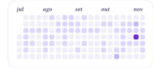

<h1 align="center">𝒐𝒊, 𝒆𝒖 𝒔𝒐𝒖 𝒂 𝒃𝒖𝒛𝒊𝒏𝒂 .. 𝒃𝒖𝒛𝒊𝒏𝒂 𝒅𝒆 𝒃𝒊𝒃𝒊</h1>

𝒔𝒐𝒖 𝒇𝒖𝒍𝒍-𝒔𝒕𝒂𝒄𝒌 𝒅𝒆𝒗𝒆𝒍𝒐𝒑𝒆𝒓 𝒆𝒎 𝒇𝒐𝒓𝒎𝒂𝒄̧𝒂̃𝒐. 𝒆𝒔𝒕𝒐𝒖 𝒏𝒐 𝒄𝒖𝒓𝒔𝒐 𝒕𝒆́𝒄𝒏𝒊𝒄𝒐 𝒅𝒆 𝒊𝒏𝒇𝒐𝒓𝒎𝒂́𝒕𝒊𝒄𝒂 𝒑𝒂𝒓𝒂 𝒊𝒏𝒕𝒆𝒓𝒏𝒆𝒕, 𝒒𝒖𝒆 𝒂𝒊𝒏𝒅𝒂 𝒏𝒂̃𝒐 𝒕𝒆𝒓𝒎𝒊𝒏𝒆𝒊: 𝒄𝒐𝒎𝒆𝒄𝒆𝒊 𝒑𝒆𝒍𝒐 𝒇𝒓𝒐𝒏𝒕-𝒆𝒏𝒅 𝒆 𝒂𝒈𝒐𝒓𝒂 𝒆𝒔𝒕𝒐𝒖 𝒆𝒔𝒕𝒖𝒅𝒂𝒏𝒅𝒐 𝒃𝒂𝒄𝒌-𝒆𝒏𝒅, 𝒂 𝒑𝒂𝒓𝒕𝒆 𝒒𝒖𝒆 𝒏𝒊𝒏𝒈𝒖𝒆́𝒎 𝒗𝒆̂, 𝒄𝒐𝒎 𝒑𝒉𝒑 𝒆 𝒔𝒒𝒍.

𝒂𝒍𝒆́𝒎 𝒅𝒐 𝒄𝒖𝒓𝒔𝒐, 𝒔𝒊𝒈𝒐 𝒆𝒔𝒕𝒖𝒅𝒂𝒏𝒅𝒐 𝒑𝒓𝒐𝒈𝒓𝒂𝒎𝒂𝒄̧𝒂̃𝒐 𝒆 𝒇𝒂𝒄̧𝒐 𝒄𝒚𝒃𝒆𝒓𝒔𝒆𝒄𝒖𝒓𝒊𝒕𝒚, 𝒐𝒏𝒅𝒆 𝒆𝒔𝒕𝒖𝒅𝒐 𝒓𝒆𝒅𝒆𝒔 𝒆 𝒔𝒆𝒈𝒖𝒓𝒂𝒏𝒄̧𝒂, 𝒑𝒐𝒓𝒒𝒖𝒆 𝒒𝒖𝒆𝒓𝒐 𝒆𝒏𝒕𝒆𝒏𝒅𝒆𝒓 𝒏𝒂̃𝒐 𝒔𝒐́ 𝒄𝒐𝒎𝒐 𝒖𝒎 𝒔𝒊𝒔𝒕𝒆𝒎𝒂 𝒆́ 𝒄𝒐𝒏𝒔𝒕𝒓𝒖𝚤́𝒅𝒐, 𝒎𝒂𝒔 𝒕𝒂𝒎𝒃𝒆́𝒎 𝒄𝒐𝒎𝒐 𝒆𝒍𝒆 𝒆́ 𝒑𝒓𝒐𝒕𝒆𝒈𝒊𝒅𝒐.

  <picture>
    <source media="(prefers-color-scheme: dark)" srcset="https://raw.githubusercontent.com/buzinei-bibi/buzinei-bibi/output/contribuicoes-dark.svg" />
    
  </picture>
  𝒆𝒔𝒕𝒖𝒅𝒂𝒏𝒅𝒐 𝒂𝒈𝒐𝒓𝒂: 𝒑𝒉𝒑, 𝒔𝒒𝒍 𝒆 𝒄𝒚𝒃𝒆𝒓𝒔𝒆𝒄𝒖𝒓𝒊𝒕𝒚 
  𝒄𝒐𝒎𝒖𝒏𝒊𝒅𝒂𝒅𝒆: 𝒎𝒆𝒎𝒃𝒓𝒂 𝒅𝒂 <a href="https://heartdevs.com/">𝒉𝒆𝟒𝒓𝒕&nbsp;𝒅𝒆𝒗𝒆𝒍𝒐𝒑𝒆𝒓𝒔</a> 
  𝒑𝒐𝒓𝒕𝒇𝒐́𝒍𝒊𝒐: <a href="https://buzina.onrender.com">𝒃𝒖𝒛𝒊𝒏𝒂.𝒐𝒏𝒓𝒆𝒏𝒅𝒆𝒓.𝒄𝒐𝒎</a>

  𝒇𝒐𝒓𝒂 𝒅𝒐 𝒄𝒐́𝒅𝒊𝒈𝒐, 𝒈𝒐𝒔𝒕𝒐 𝒅𝒆 𝒇𝒖𝒕𝒆𝒃𝒐𝒍, 𝒕𝒆̂𝒏𝒊𝒔 𝒅𝒆 𝒎𝒆𝒔𝒂, 𝒗𝒐̂𝒍𝒆𝒊, 𝒂𝒏𝒊𝒎𝒆𝒔 𝒆 𝒅𝒆 𝒐𝒖𝒗𝒊𝒓 𝒎𝒖́𝒔𝒊𝒄𝒂 𝒐 𝒕𝒆𝒎𝒑𝒐 𝒕𝒐𝒅𝒐, 𝒔𝒆𝒎𝒑𝒓𝒆 𝒂𝒄𝒐𝒎𝒑𝒂𝒏𝒉𝒂𝒅𝒂 𝒅𝒆 𝒖𝒎 𝒎𝒐𝒏𝒔𝒕𝒆𝒓. 𝒔𝒆 𝒆𝒖 𝒏𝒂̃𝒐 𝒆𝒔𝒕𝒊𝒗𝒆𝒓 𝒆𝒔𝒕𝒖𝒅𝒂𝒏𝒅𝒐 𝒐𝒖 𝒇𝒂𝒍𝒂𝒏𝒅𝒐 𝒔𝒐𝒃𝒓𝒆 𝒇𝒖𝒕𝒆𝒃𝒐𝒍, 𝒑𝒓𝒐𝒗𝒂𝒗𝒆𝒍𝒎𝒆𝒏𝒕𝒆 𝒆𝒔𝒕𝒂𝒓𝒆𝒊 𝒃𝒖𝒛𝒊𝒏𝒂𝒏𝒅𝒐 𝒃𝒊𝒃𝒊 🚗

---

## 𝒉𝒆𝟒𝒓𝒕 𝒅𝒆𝒗𝒆𝒍𝒐𝒑𝒆𝒓𝒔

𝒄𝒐𝒏𝒕𝒓𝒊𝒃𝒖𝒐 𝒄𝒐𝒎 𝒂 𝒄𝒐𝒎𝒖𝒏𝒊𝒅𝒂𝒅𝒆 𝒆𝒎 𝒊𝒏𝒊𝒄𝒊𝒂𝒕𝒊𝒗𝒂𝒔 𝒅𝒆 𝒐𝒑𝒆𝒏 𝒔𝒐𝒖𝒓𝒄𝒆 𝒆 𝒄𝒐𝒎 𝒑𝒖𝒍𝒍 𝒓𝒆𝒒𝒖𝒆𝒔𝒕𝒔. 
𝒄𝒐𝒏𝒔𝒊𝒅𝒆𝒓𝒐 𝒂 𝒉𝒆𝟒𝒓𝒕 𝒅𝒆𝒗𝒆𝒍𝒐𝒑𝒆𝒓𝒔 𝒎𝒊𝒏𝒉𝒂 𝒕𝒆𝒓𝒄𝒆𝒊𝒓𝒂 𝒄𝒂𝒔𝒂, 𝒑𝒐𝒓𝒒𝒖𝒆 𝒍𝒂́ 𝒗𝒂𝒊 𝒎𝒖𝒊𝒕𝒐 𝒂𝒍𝒆́𝒎 𝒅𝒆 𝒄𝒐́𝒅𝒊𝒈𝒐: 𝒆́ 𝒔𝒐𝒃𝒓𝒆 𝒑𝒆𝒔𝒔𝒐𝒂𝒔, 𝒄𝒐𝒍𝒂𝒃𝒐𝒓𝒂𝒄̧𝒂̃𝒐, 𝒂𝒑𝒓𝒆𝒏𝒅𝒊𝒛𝒂𝒅𝒐 𝒆 𝒕𝒓𝒐𝒄𝒂 𝒅𝒆 𝒆𝒙𝒑𝒆𝒓𝒊𝒆̂𝒏𝒄𝒊𝒂𝒔.

---

## 𝒇𝒆𝒓𝒓𝒂𝒎𝒆𝒏𝒕𝒂𝒔 𝒆 𝒕𝒆𝒄𝒏𝒐𝒍𝒐𝒈𝒊𝒂𝒔

  <picture><source media="(prefers-color-scheme: dark)" srcset="assets/skills/front-end-dark.svg" /></picture>
  <picture><source media="(prefers-color-scheme: dark)" srcset="assets/skills/back-end-dark.svg" /></picture>
  <picture><source media="(prefers-color-scheme: dark)" srcset="assets/skills/ferramentas-dark.svg" /></picture>

---

## 𝒑𝒓𝒐𝒋𝒆𝒕𝒐𝒔 𝒆𝒎 𝒅𝒆𝒔𝒕𝒂𝒒𝒖𝒆

  <a href="https://github.com/buzinei-bibi/esportes"><picture><source media="(prefers-color-scheme: dark)" srcset="assets/projetos/taubate-dark.svg" /></picture></a>
  <a href="https://github.com/buzinei-bibi/bot-perguntas"><picture><source media="(prefers-color-scheme: dark)" srcset="assets/projetos/he4rt-quiz-dark.svg" /></picture></a>

  <a href="https://github.com/buzinei-bibi/f1"><picture><source media="(prefers-color-scheme: dark)" srcset="assets/projetos/f1-dark.svg" /></picture></a>
  <a href="https://github.com/buzinei-bibi/buzina"><picture><source media="(prefers-color-scheme: dark)" srcset="assets/projetos/buzina-dark.svg" /></picture></a>

---

## 𝒐𝒏𝒅𝒆 𝒎𝒆 𝒆𝒏𝒄𝒐𝒏𝒕𝒓𝒂𝒓?

𝒔𝒆 𝒆𝒖 𝒏𝒂̃𝒐 𝒆𝒔𝒕𝒊𝒗𝒆𝒓 𝒃𝒖𝒛𝒊𝒏𝒂𝒏𝒅𝒐, 𝒗𝒐𝒄𝒆̂ 𝒑𝒓𝒐𝒗𝒂𝒗𝒆𝒍𝒎𝒆𝒏𝒕𝒆 𝒑𝒐𝒅𝒆 𝒎𝒆 𝒆𝒏𝒄𝒐𝒏𝒕𝒓𝒂𝒓 𝒑𝒐𝒓 𝒂𝒒𝒖𝒊:

  <a href="https://buzina.onrender.com"><picture><source media="(prefers-color-scheme: dark)" srcset="assets/contato/portfolio-dark.svg" /></picture></a>
  <a href="https://www.linkedin.com/in/biancavs/"><picture><source media="(prefers-color-scheme: dark)" srcset="assets/contato/linkedin-dark.svg" /></picture></a>
  <a href="https://www.instagram.com/biibii_crf"><picture><source media="(prefers-color-scheme: dark)" srcset="assets/contato/instagram-dark.svg" /></picture></a>

